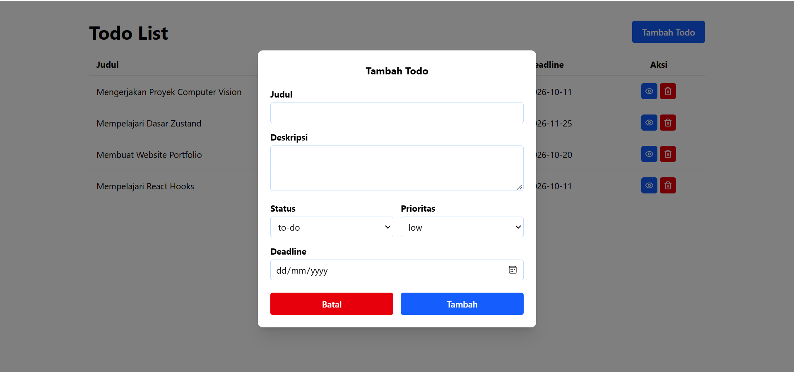
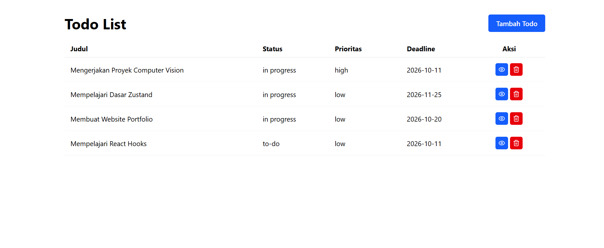
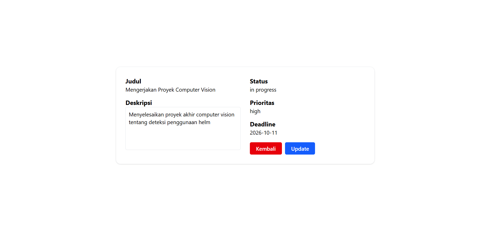
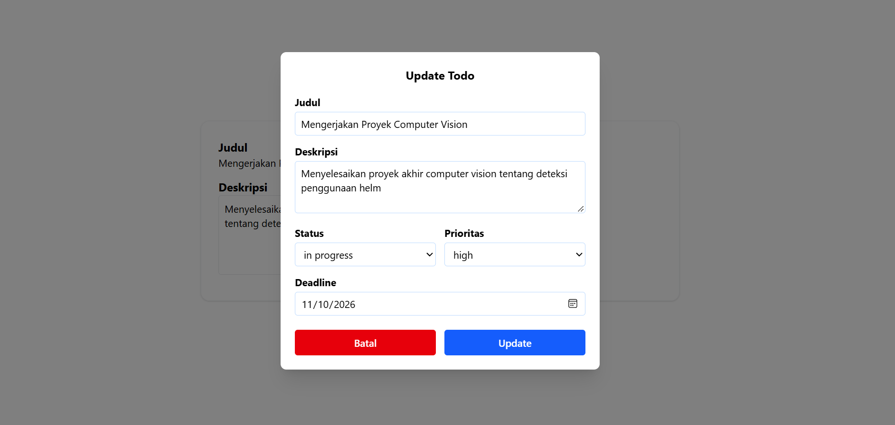
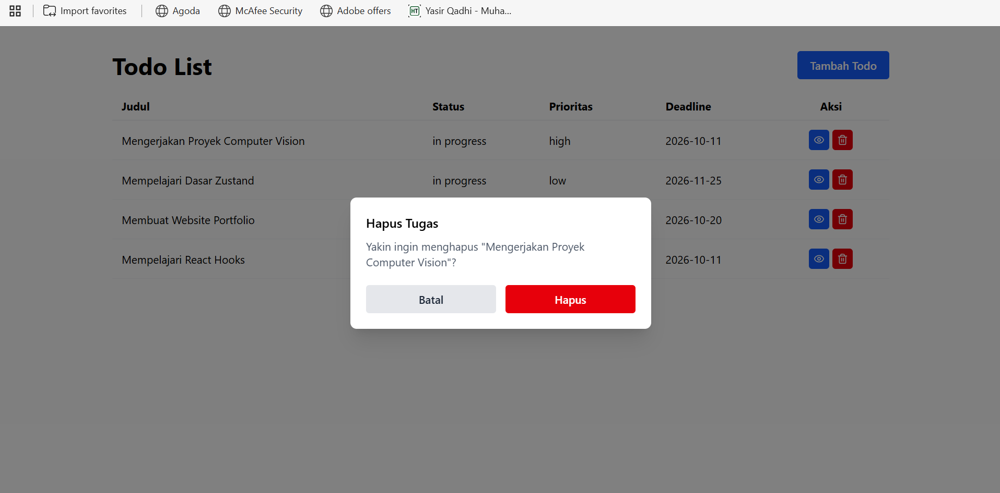

# Todo List - React.js

Aplikasi To-Do List frontend menggunakan React.js, dengan data dummy dan React State (tanpa backend).

## Fitur

- Menampilkan daftar tugas
- Melihat detail tugas
- Menambahkan tugas
- Memperbarui tugas
- Menghapus tugas (dengan konfirmasi)
- Notifikasi (toast) setelah tambah, ubah, dan hapus

## Teknologi

- React 19 + Vite
- React Router
- Tailwind CSS
- Lucide React

## Struktur Data

```js
{
  id: 1,
  title: "Judul tugas",
  description: "Deskripsi tugas",
  priority: "low | medium | high",
  deadline: "YYYY-MM-DD",
  status: "to-do | in progress | done"
}
```


Buka `http://localhost:5173`.

## Screenshot

### Modal Tambah Todo


### Halaman Daftar


### Halaman Detail


### Modal Update Todo


### Konfirmasi Hapus

